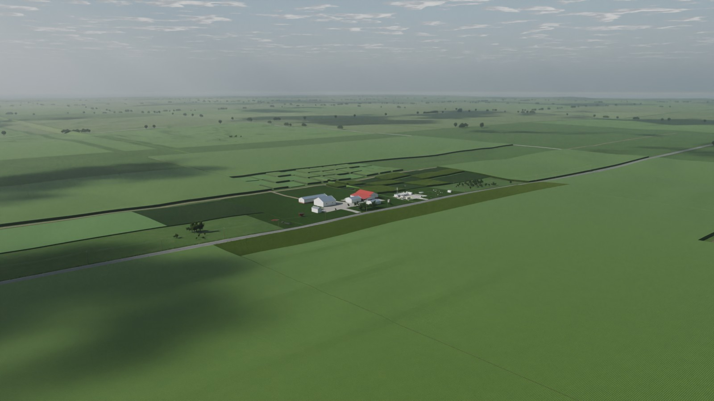
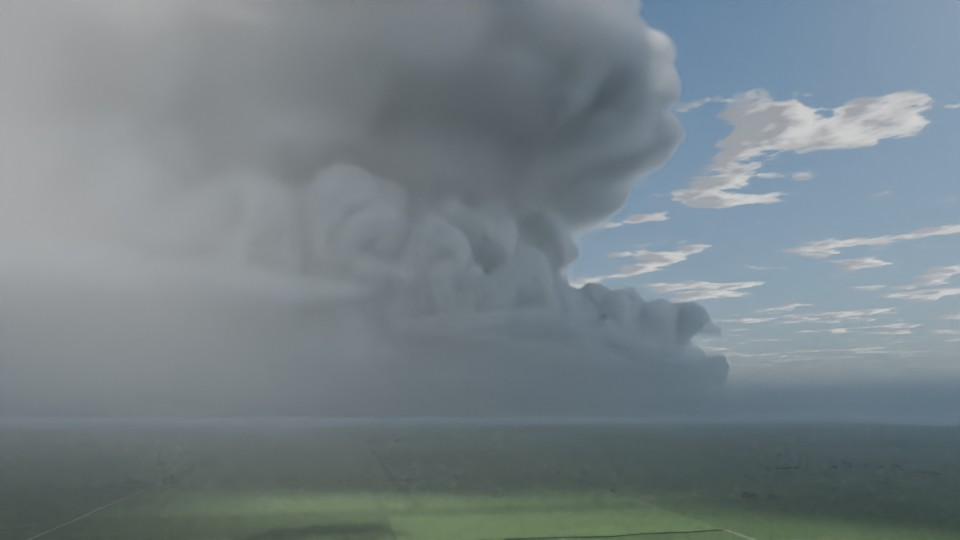
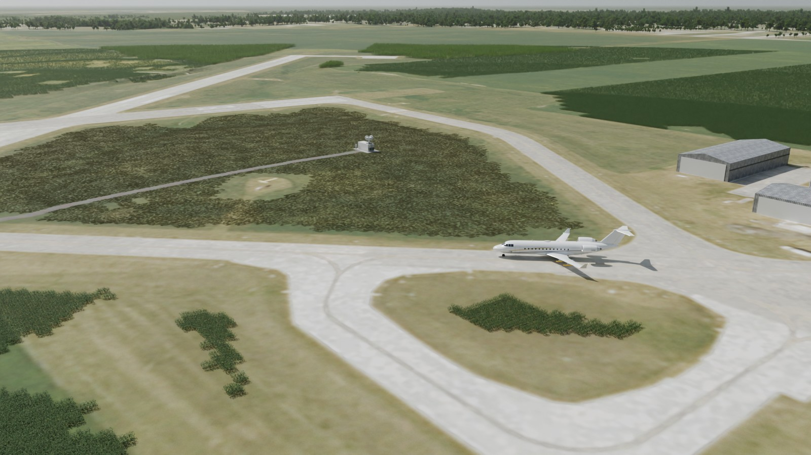
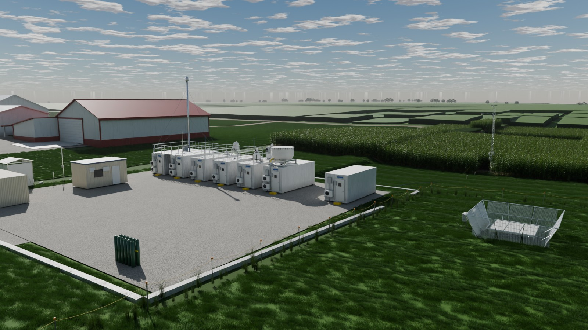

# ablemodels — ARM Blender models

Procedural Blender models of ARM Mobile Facility sites and instruments, built for the
DERECHOS campaign (Iowa–Illinois). The repository is **self-contained and runnable**: every
scene links its assets from the asset folders by relative path, so a fresh clone opens and
renders with no missing files.

Requires **Blender 5.2 LTS** or newer (files were written with 5.2.3).

| | | |
|---|---|---|
|  |  |  |
| CM1 supercell over M1 (`scenes/tests/m1_supercell.blend`) | S2, Washington Municipal Airport | AMF2 container row at M1 |

## Layout

| Folder | What is in it |
|---|---|
| [`instruments/`](instruments/) | One `.blend` per ARM instrument (AERI, KAZR, DL, MPL, MWR3C, MET tower, ECOR, SEBS, SIRS, RWP, …) plus the C-SAPR2 radar, the KAWG AWOS, the radiosonde balloon launch (balloon, sonde, line and launch crew, animated), and the DERECHOS additions: MRR micro rain radar, stand-alone METWXT, GNDRAD upwelling radiometers with ground-viewing IRT, STAMP and SoilVUE10 soil profiles, and a PhenoCam mast |
| [`containers/`](containers/) | AMF2 instrument containers, AOS platform, office shelter, and the SACR container (M1 and S2 versions) |
| [`buildings/`](buildings/) | Farmstead (M1), MIRF buildings and center pivots (S1), KAWG hangars and terminal (S2), Louisa power station, flagpole, site signs |
| [`vehicles/`](vehicles/) | Farm vehicles and implements, and the ARM Challenger 850 research aircraft |
| [`plants/`](plants/) | Corn and soybean variants, lawn and tall grass, tree sets (standard and high-detail), native prairie flowers |
| [`clouds/`](clouds/) | Mature-cloud snapshots as OpenVDB volumes with their shaders: LASSO SGP cumulus, UCLA cumulus, CM1 BOMEX cumulus, CM1 supercells |
| [`scenes/`](scenes/) | The three DERECHOS sites (M1, S1, S2) and test scenes; site-specific terrain/vegetation layers live in `scenes/<site>/layers/` |
| [`textures/`](textures/) | Shared image textures (PBR material sets, NAIP orthoimagery, sign and flag artwork) |
| [`tools/`](tools/) | Scripts that built this library from the original working files, plus build/verification reports |

Every asset folder has a `preview/` subfolder with renders of what it contains, and a
`README.md` catalogue (file, collection name, preview).

### Scenes

| Scene | Site |
|---|---|
| `scenes/M1/M1.blend` | M1 — main AMF2 site on the farm (instrument field, AMF2 containers, farmstead, fields) |
| `scenes/S1/S1.blend` | S1 — Muscatine Island Research Farm (ECORs in corn and soy, SEBS, center pivots, Louisa plant on the horizon) |
| `scenes/S2/S2.blend` | S2 — Washington Municipal Airport, KAWG (X/Ka SACR, C-SAPR2, AWOS, Challenger 850) |
| `scenes/tests/instrument_lineup.blend` | Every instrument asset in a row |
| `scenes/tests/m1_supercell.blend` | M1 with the CM1 100 m supercell (snapshot `c100_t25`) placed as in the storm renders |
| `scenes/tests/m1_lasso_cumulus.blend` | M1 under the LASSO SGP cumulus field |
| `scenes/tests/s1_ucla_cumulus.blend` | S1 under the UCLA LES cumulus field |

## How the linking works

Blender can **link** data from another `.blend` instead of copying it
(*File → Link*). A linked collection stays read-only in the scene and is re-read from its
source file every time the scene opens, so fixing `instruments/KAZR/KAZR.blend` updates every
scene that uses the KAZR. All paths are stored relative to the file (`//../../instruments/...`),
which is what makes the repository portable.

Re-usable assets (instruments, containers, vehicles, pivots, flagpole) are stored with their
root at the origin. Scenes place them with a **collection-instance empty** (named
`<collection>_inst`) carrying the location and rotation, so one asset can be placed many
times. Site-specific layers (terrain, fields, farmstead buildings, vegetation scatter) are
stored in their real-world site coordinates and linked in place.

Common tasks:

* **Use an asset in your own scene:** *File → Link*, browse into the `.blend`, open
  `Collection`, pick the collection (e.g. `INST_KAZR`). It arrives as an instance you can move.
* **Asset Browser:** add the repository root under *Preferences → File Paths → Asset
  Libraries*; all asset collections are marked as assets.
* **Pose a linked asset** (C-SAPR2 azimuth/elevation, Challenger 850 gear, flaps and fans,
  AWOS wind vane): right-click the instance → *Library Override → Make → Selected & Content*,
  then edit the custom properties on its `*_root` object; drivers on the parts read those
  properties. The SACR azimuth/elevation is keyframed on `SACR_Azimuth`/`SACR_Elevation`.
* **Edit an asset:** open its own `.blend` and save; every scene picks up the change.
* **Make a copy you can edit locally:** *Object → Apply → Make Instances Real*, or
  *Object → Relations → Make Local*.

## Clouds

Each cloud `.blend` has one collection per snapshot (`CLOUD_<name>`); the VDB files sit next
to it. Volume objects read the model's own grids (CM1: `cloud`, `rain`, `ice`, `snow`,
`graup`, `cice`; LES: `lwc`). The CM1 storm shader renders each hydrometeor species with its
own scattering and uses the raw model fields (no procedural noise).

VDBs larger than 50 MB (the three 100 m supercell snapshots) were rewritten with 16-bit
half-float storage to stay under GitHub's 100 MB file limit. Grid resolution, extent and all
species are unchanged; half precision keeps about three significant digits of the mixing
ratio, below what a volume render can show. Nothing was resampled.

## Provenance and verification

The library was generated from the original monolithic working files (`farm_v5.blend`,
`mirf_s1.blend`, `airport_awg.blend` and the cloud scenes) by the scripts in `tools/`
(`build_m1.py`, `build_s1.py`, `build_s2.py`, `build_clouds.py`, `build_tests.py`). The
extraction is lossless: each rebuilt scene was evaluated against its source and has the same
number of mesh instances, the same total vertex count and identical summed world positions
(reports in `tools/reports/`), and test renders match the originals to within sampling noise.
Text objects that used macOS system fonts were converted to meshes so they render the same
on any OS.

Deliberate differences from the working files:

* At M1 the SACR container instance is hidden (the SACR moved to S2 for DERECHOS).
* Instruments, containers and vehicles are instanced rather than embedded (see above).

## Licences of third-party content

* PBR texture sets in `textures/pbr/` are from [ambientCG](https://ambientcg.com) (CC0).
* Orthoimagery in `textures/imagery/` is USDA NAIP (public domain); the M1 height fields
  (`hf_*.exr`) are terrain elevation grids, stored with lossless ZIP compression.
* Site signs and flags (`textures/signs/`, `textures/flags/`) carry partner and agency logos;
  check their usage rules before reusing them outside DERECHOS/ARM material.
