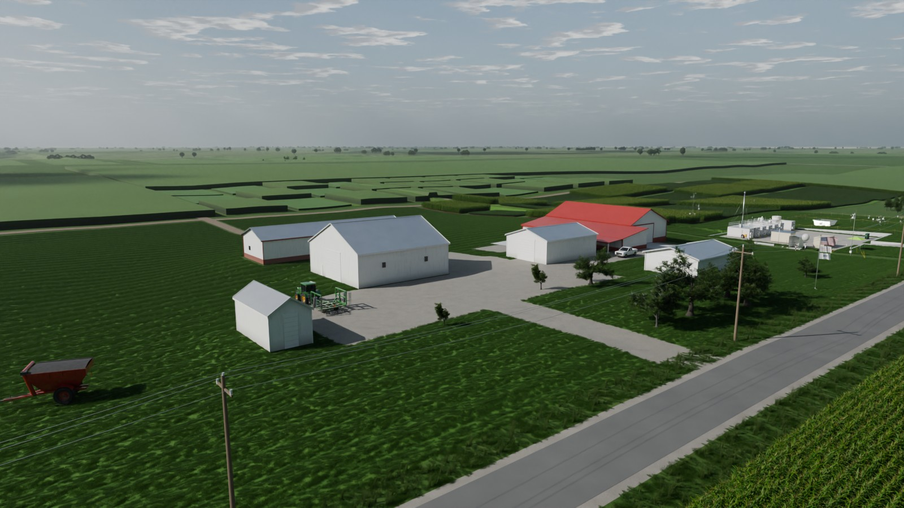
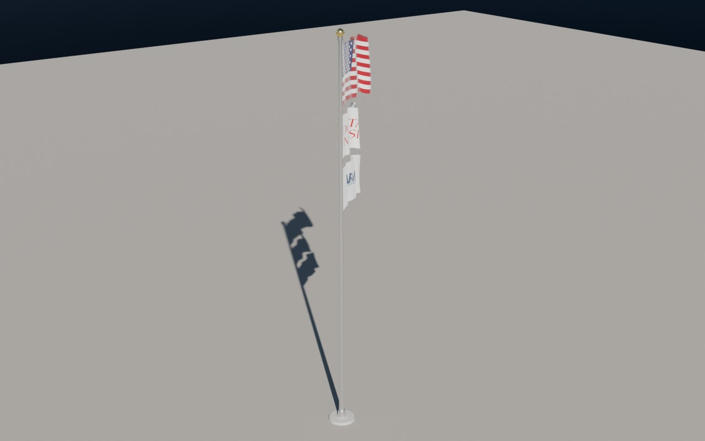
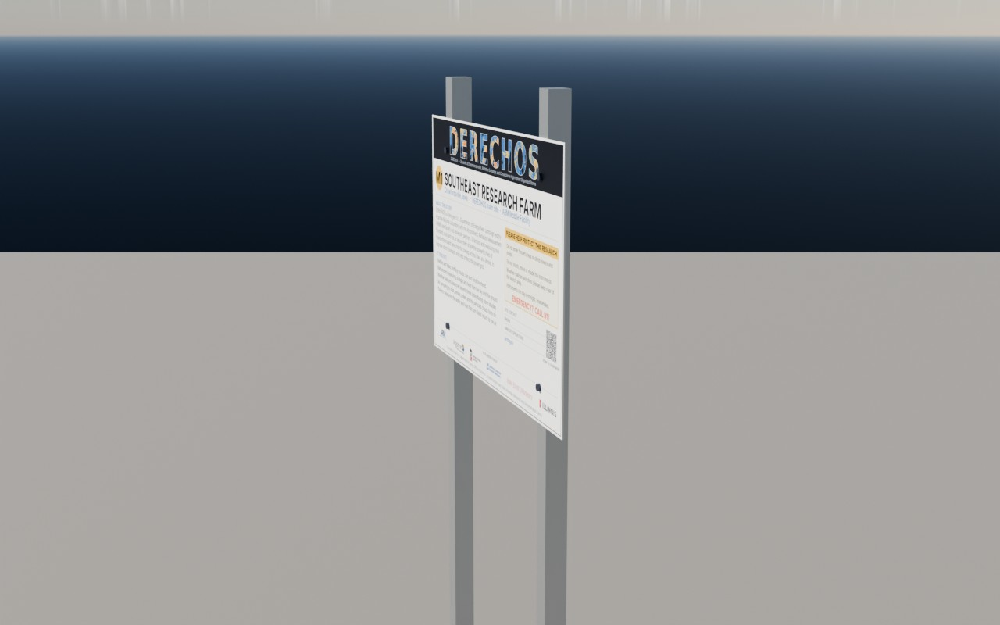
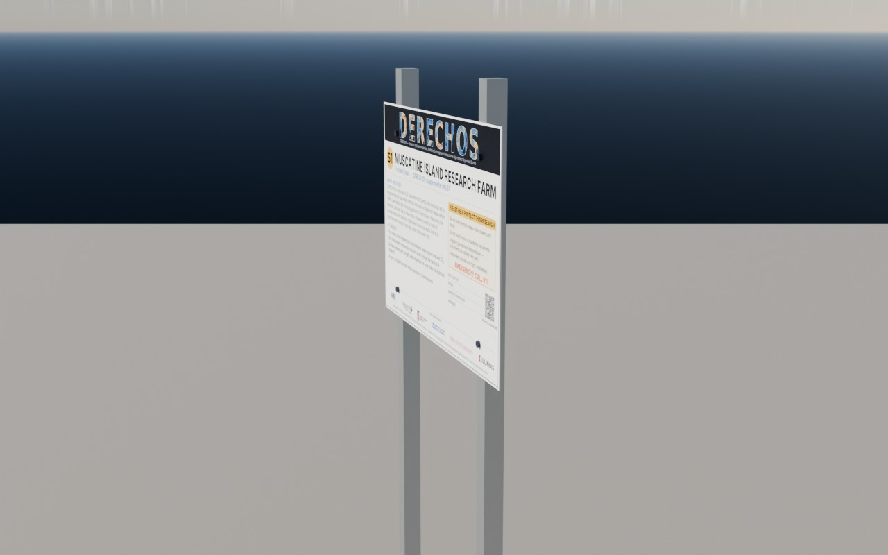
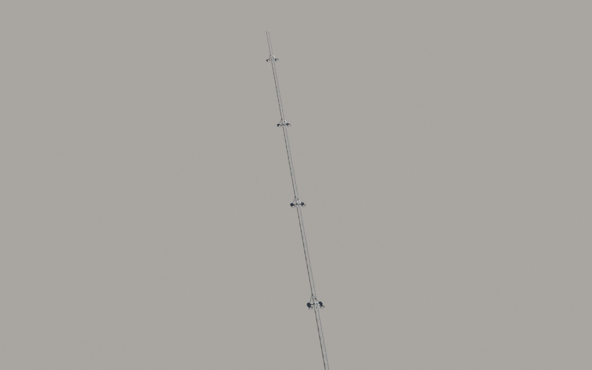
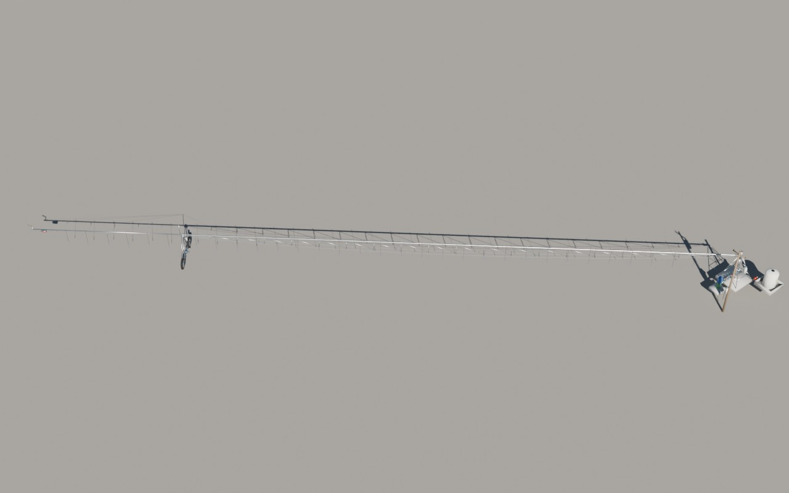
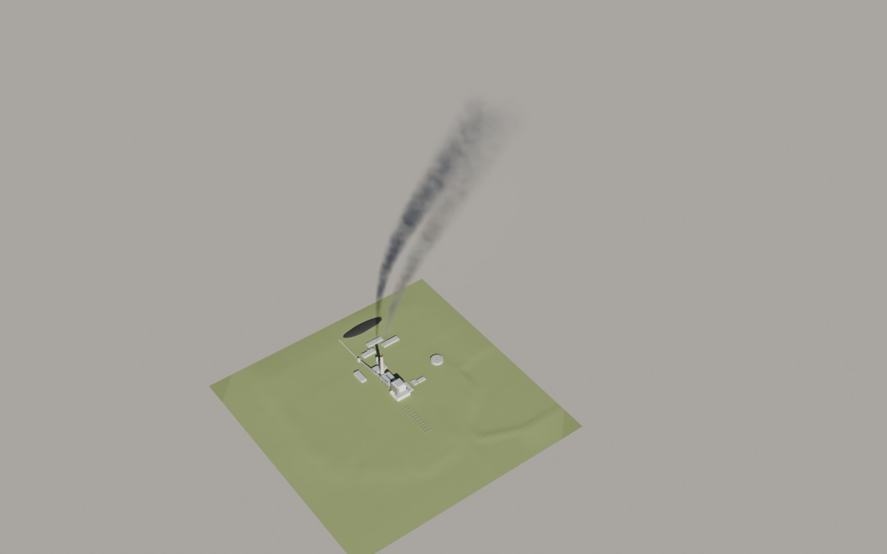
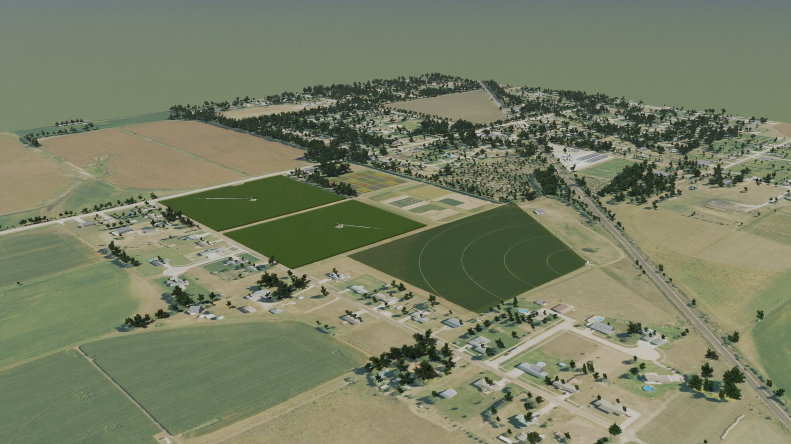
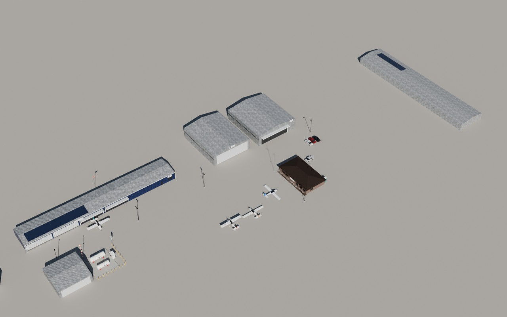

# Buildings and structures

Site buildings are stored in site coordinates; the flagpole and center pivots are re-usable (root at the origin).

| Preview | Collection | File |
|---|---|---|
|  | `Farmstead` | [`m1_farmstead.blend`](m1_farmstead.blend) (0.3 MB) |
|  | `Flagpole` | [`flagpole.blend`](flagpole.blend) (0.2 MB) |
|  | `SIGN_M1` | [`signs/sign_M1.blend`](signs/sign_M1.blend) (0.9 MB) |
|  | `SIGN_S1` | [`signs/sign_S1.blend`](signs/sign_S1.blend) (0.9 MB) |
|  | `SIGN_S2` | [`signs/sign_S2.blend`](signs/sign_S2.blend) (0.9 MB) |
|  | `Pivot_P3` | [`center_pivots.blend`](center_pivots.blend) (1.5 MB) |
|  | `Pivot_P1` | [`center_pivots.blend`](center_pivots.blend) (1.5 MB) |
|  | `LOUISA_Station` | [`louisa_station.blend`](louisa_station.blend) (0.4 MB) |
|  | `S1_MIRF_Buildings` | [`s1_mirf_buildings.blend`](s1_mirf_buildings.blend) (0.1 MB) |
|  | `S2_KAWG_Buildings` | [`s2_kawg_buildings.blend`](s2_kawg_buildings.blend) (1.8 MB) |
