# Clouds

Mature snapshots; one collection per snapshot, VDB next to the .blend. Tiled LES fields (LASSO 3x3, UCLA 7x7) keep their periodic tiling.

| Preview | Collection | File |
|---|---|---|
| 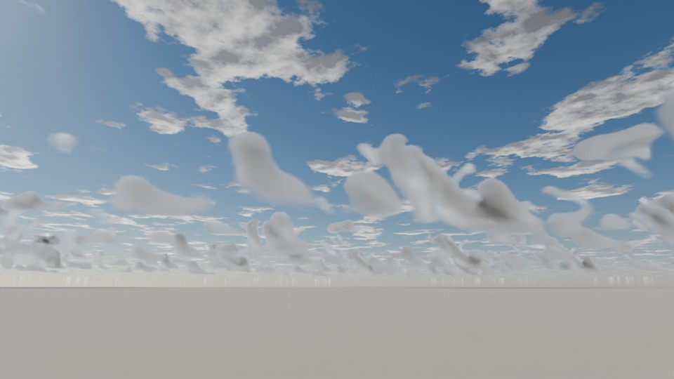 | `CLOUD_bomex_t360` | [`cm1_bomex_cumulus/cm1_bomex_cumulus.blend`](cm1_bomex_cumulus/cm1_bomex_cumulus.blend) (0.1 MB) |
| 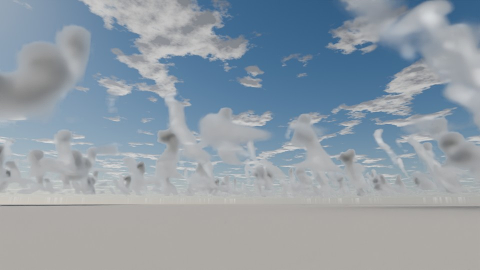 | `CLOUD_bomex_t300` | [`cm1_bomex_cumulus/cm1_bomex_cumulus.blend`](cm1_bomex_cumulus/cm1_bomex_cumulus.blend) (0.1 MB) |
| 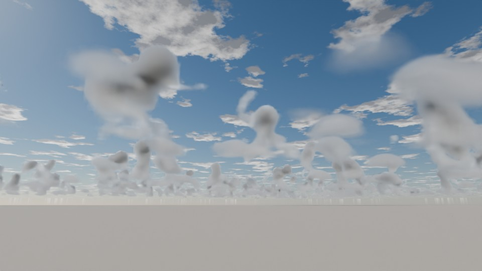 | `CLOUD_bomex_t240` | [`cm1_bomex_cumulus/cm1_bomex_cumulus.blend`](cm1_bomex_cumulus/cm1_bomex_cumulus.blend) (0.1 MB) |
| 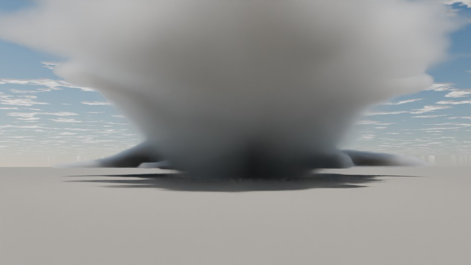 | `CLOUD_supercell_s250_t60` | [`cm1_supercell/cm1_supercell.blend`](cm1_supercell/cm1_supercell.blend) (0.1 MB) |
| 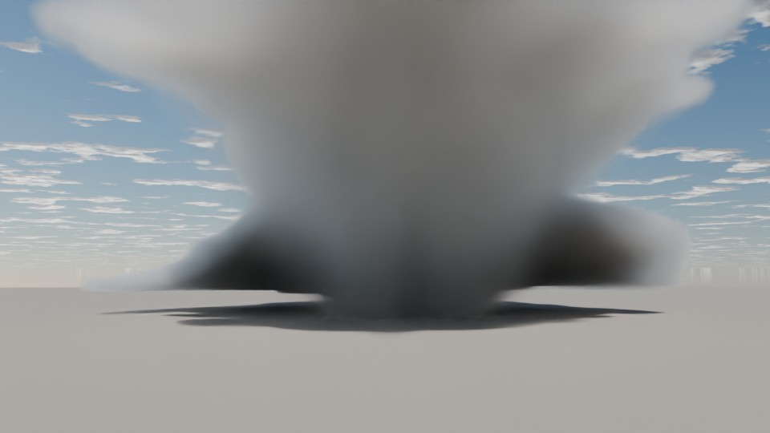 | `CLOUD_supercell_s250_t45` | [`cm1_supercell/cm1_supercell.blend`](cm1_supercell/cm1_supercell.blend) (0.1 MB) |
| 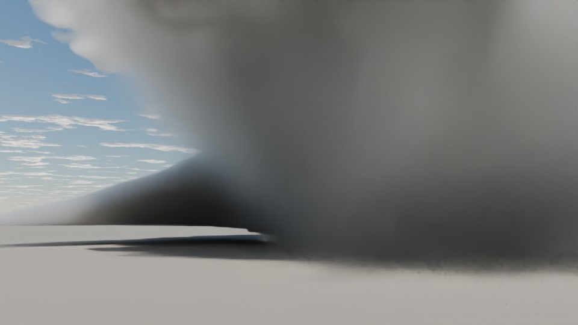 | `CLOUD_supercell_s100_t60` | [`cm1_supercell/cm1_supercell.blend`](cm1_supercell/cm1_supercell.blend) (0.1 MB) |
| 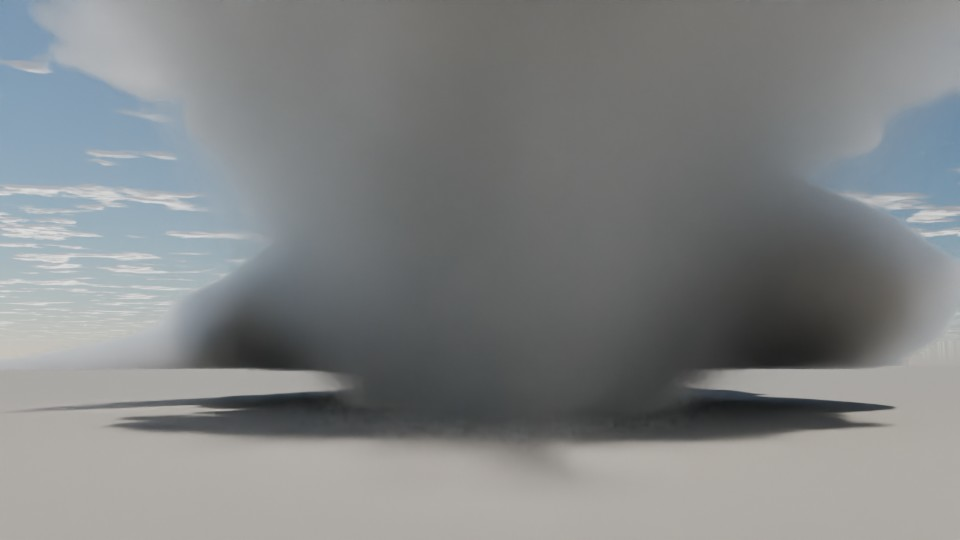 | `CLOUD_supercell_s100_t45` | [`cm1_supercell/cm1_supercell.blend`](cm1_supercell/cm1_supercell.blend) (0.1 MB) |
| 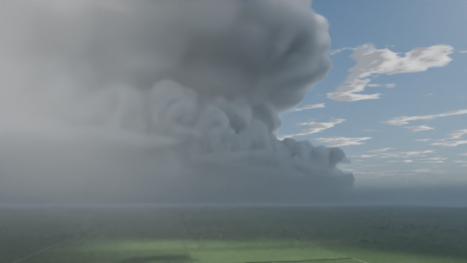 | `CLOUD_supercell_c100_t25` | [`cm1_supercell/cm1_supercell.blend`](cm1_supercell/cm1_supercell.blend) (0.1 MB) |
| 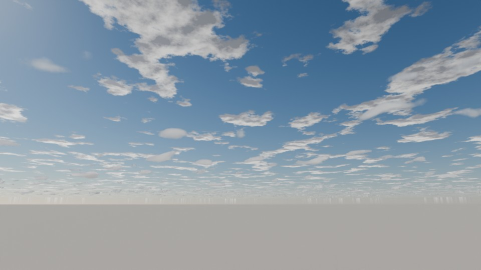 | `CLOUD_lasso_2000` | [`lasso_sgp_20170403/lasso_sgp_20170403.blend`](lasso_sgp_20170403/lasso_sgp_20170403.blend) (0.1 MB) |
| 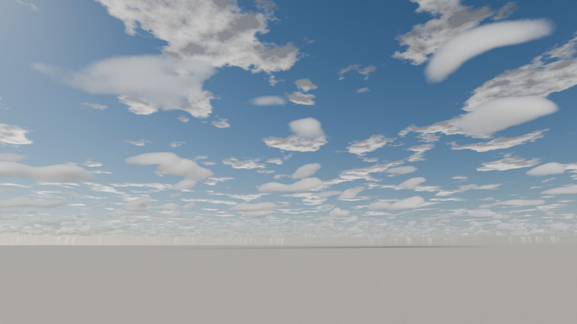 | `CLOUD_lasso_1900` | [`lasso_sgp_20170403/lasso_sgp_20170403.blend`](lasso_sgp_20170403/lasso_sgp_20170403.blend) (0.1 MB) |
|  | `CLOUD_lasso_1800` | [`lasso_sgp_20170403/lasso_sgp_20170403.blend`](lasso_sgp_20170403/lasso_sgp_20170403.blend) (0.1 MB) |
|  | `CLOUD_lasso_1740` | [`lasso_sgp_20170403/lasso_sgp_20170403.blend`](lasso_sgp_20170403/lasso_sgp_20170403.blend) (0.1 MB) |
| 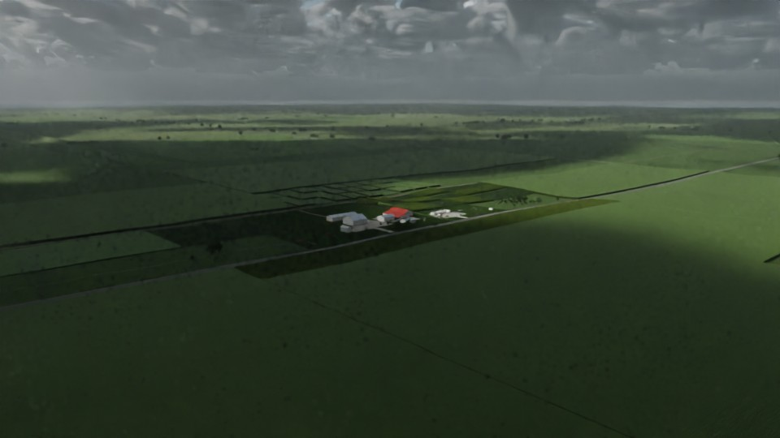 | `CLOUD_lasso8_2040` | [`lasso_sgp_20170403/lasso_sgp_20170403.blend`](lasso_sgp_20170403/lasso_sgp_20170403.blend) (0.1 MB) |
| 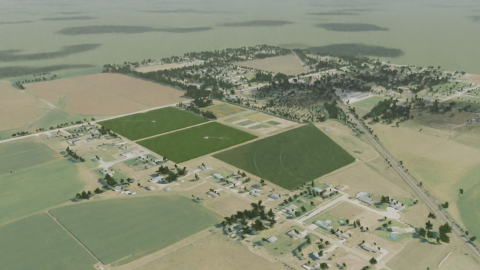 | `CLOUD_ucla_t6600` | [`ucla_cumulus/ucla_cumulus.blend`](ucla_cumulus/ucla_cumulus.blend) (0.1 MB) |

VDB files:

* `cm1_bomex_cumulus/bomex50_t240_x5.vdb` (2.9 MB)
* `cm1_bomex_cumulus/bomex50_t300_x5.vdb` (3.2 MB)
* `cm1_bomex_cumulus/bomex50_t360_x5.vdb` (2.4 MB)
* `cm1_supercell/c100_t25_sp.vdb` (80.8 MB)
* `cm1_supercell/s100_t45_sp.vdb` (42.4 MB)
* `cm1_supercell/s100_t60_sp.vdb` (77.5 MB)
* `cm1_supercell/s250_t45_sp.vdb` (5.5 MB)
* `cm1_supercell/s250_t60_sp.vdb` (12.6 MB)
* `lasso_sgp_20170403/lasso8_2040_lwc.vdb` (20.2 MB)
* `lasso_sgp_20170403/lasso_1740_lwc.vdb` (2.2 MB)
* `lasso_sgp_20170403/lwc_0145.vdb` (2.1 MB)
* `lasso_sgp_20170403/lwc_0193.vdb` (1.2 MB)
* `lasso_sgp_20170403/lwc_0241.vdb` (0.4 MB)
* `ucla_cumulus/ucla_t6600_m.vdb` (0.5 MB)
