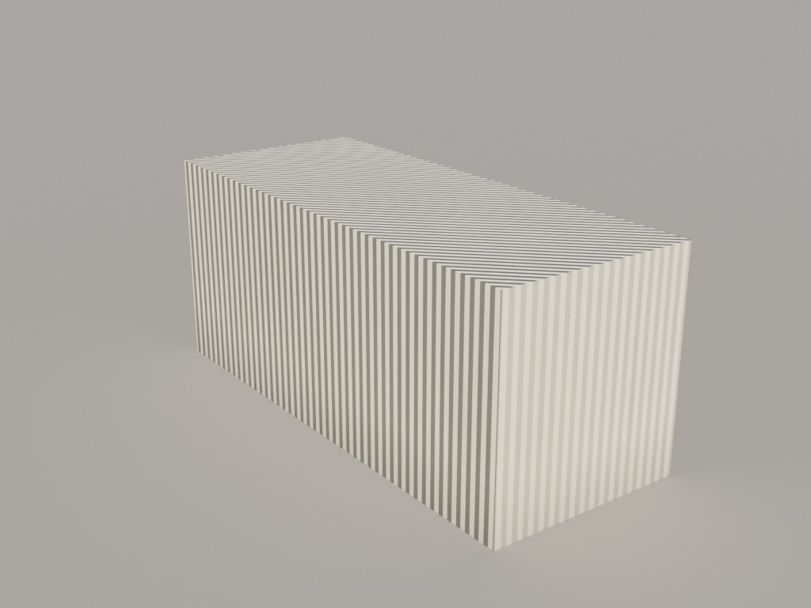
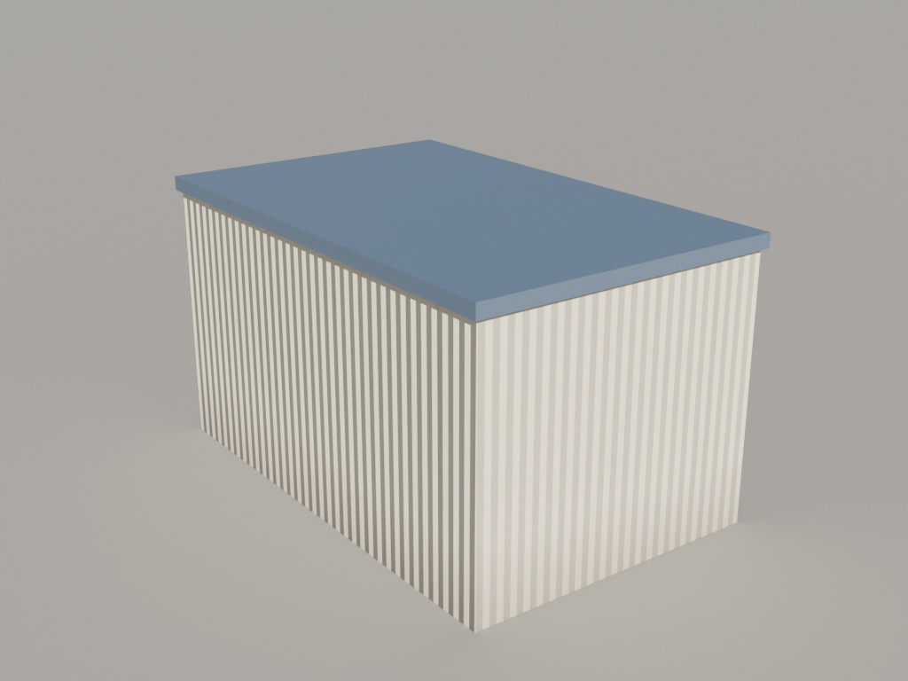
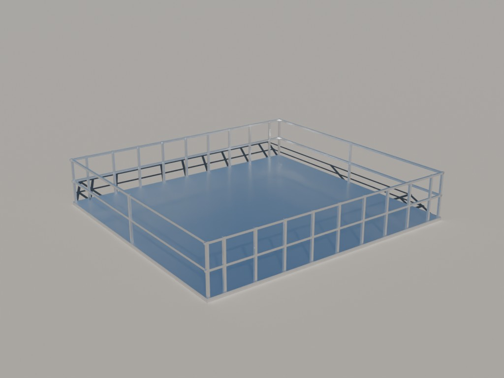
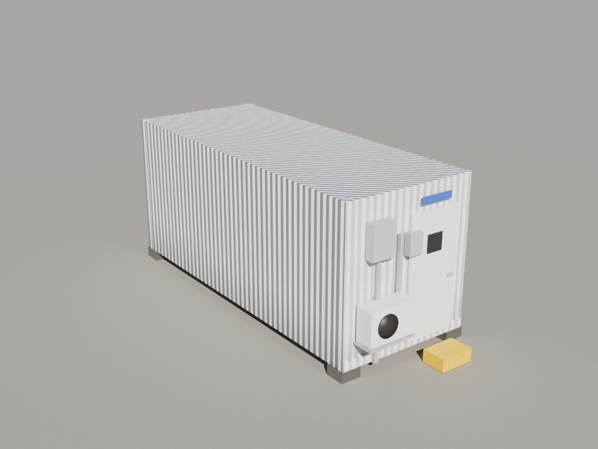
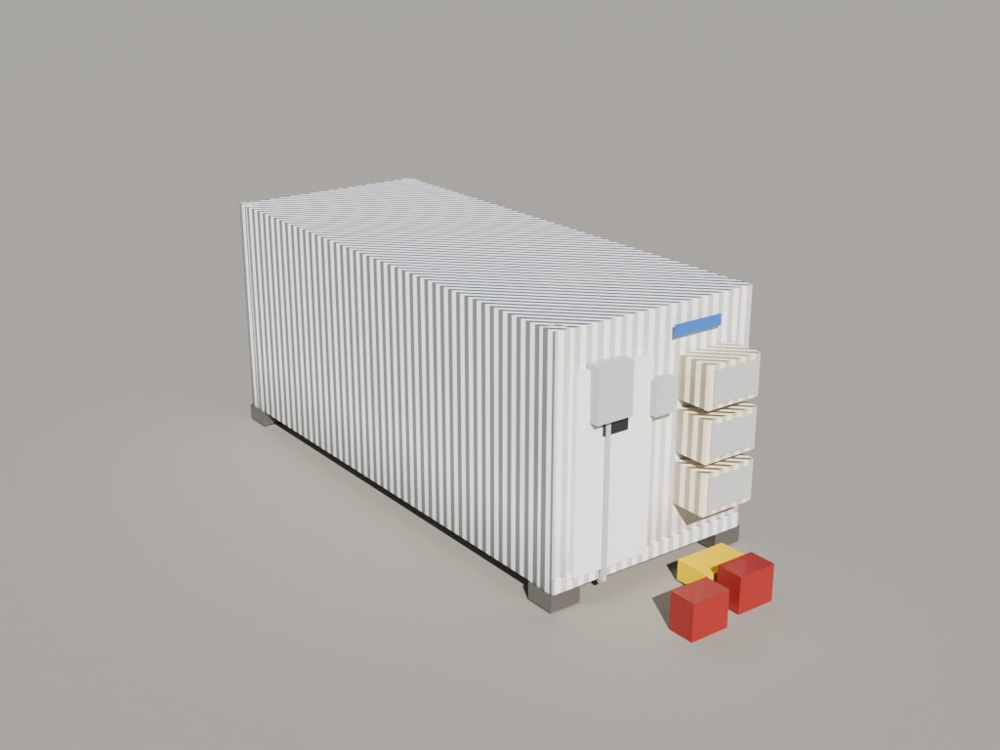
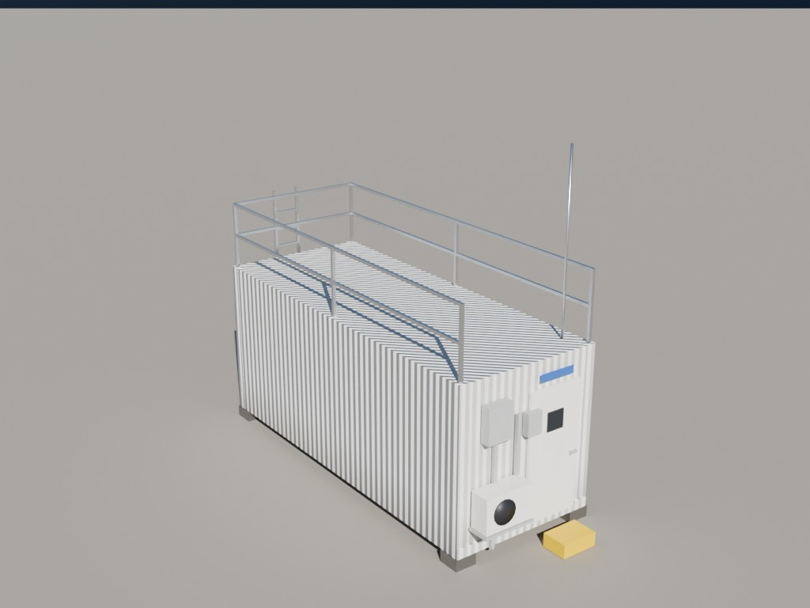
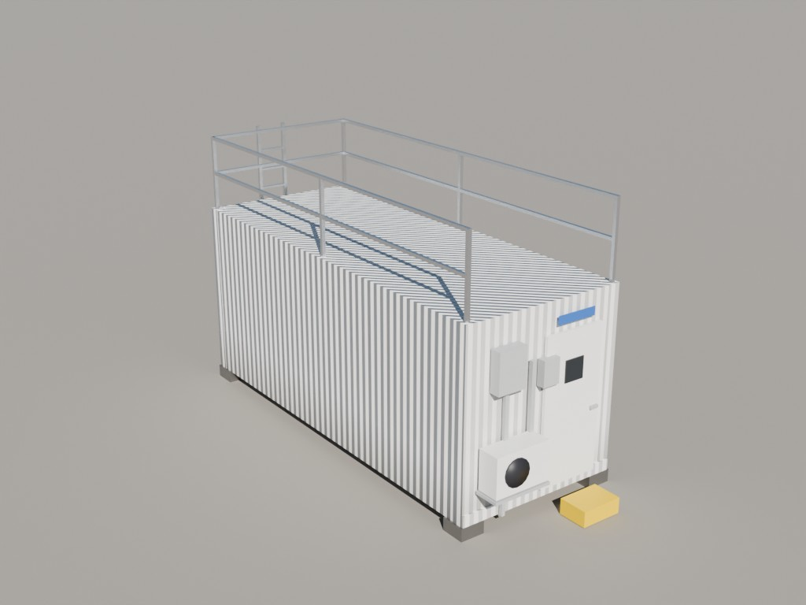
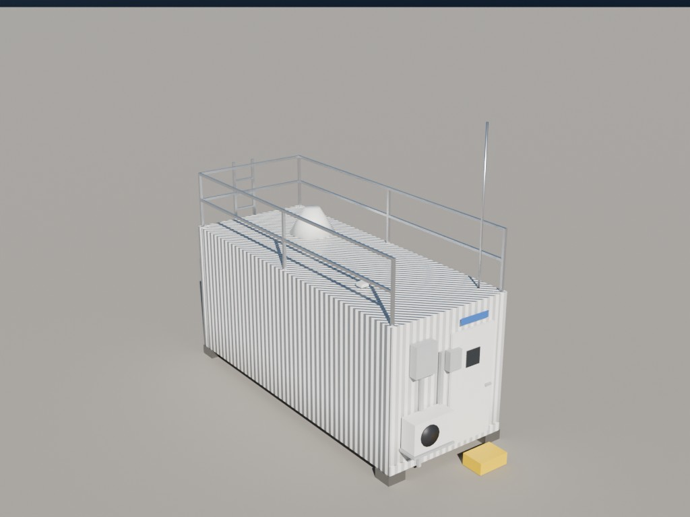
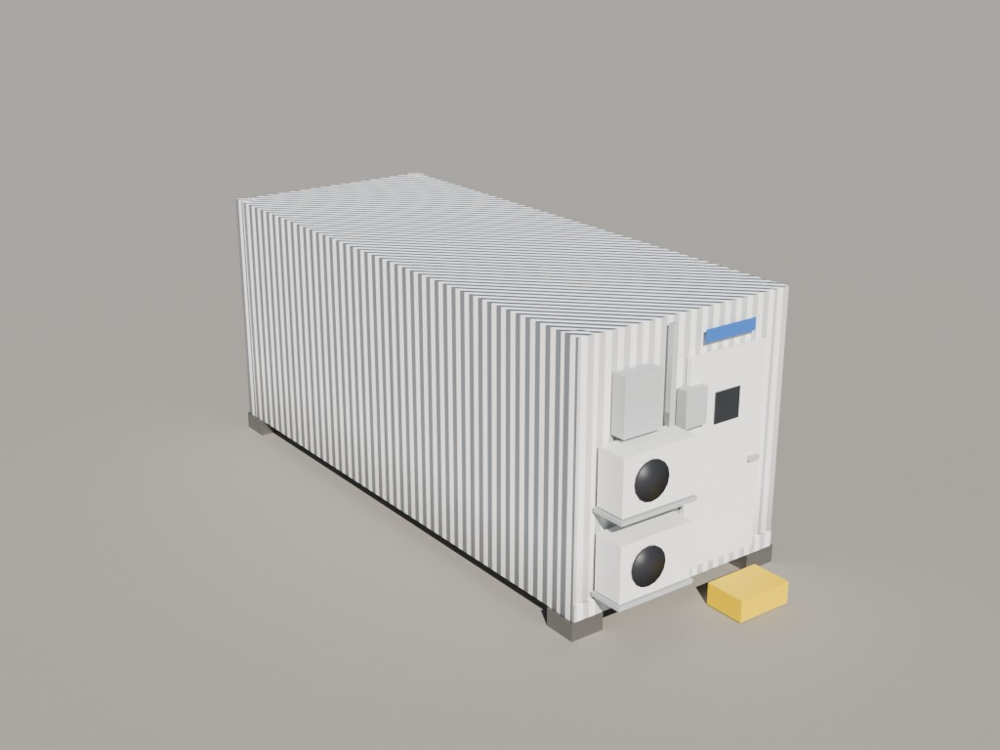
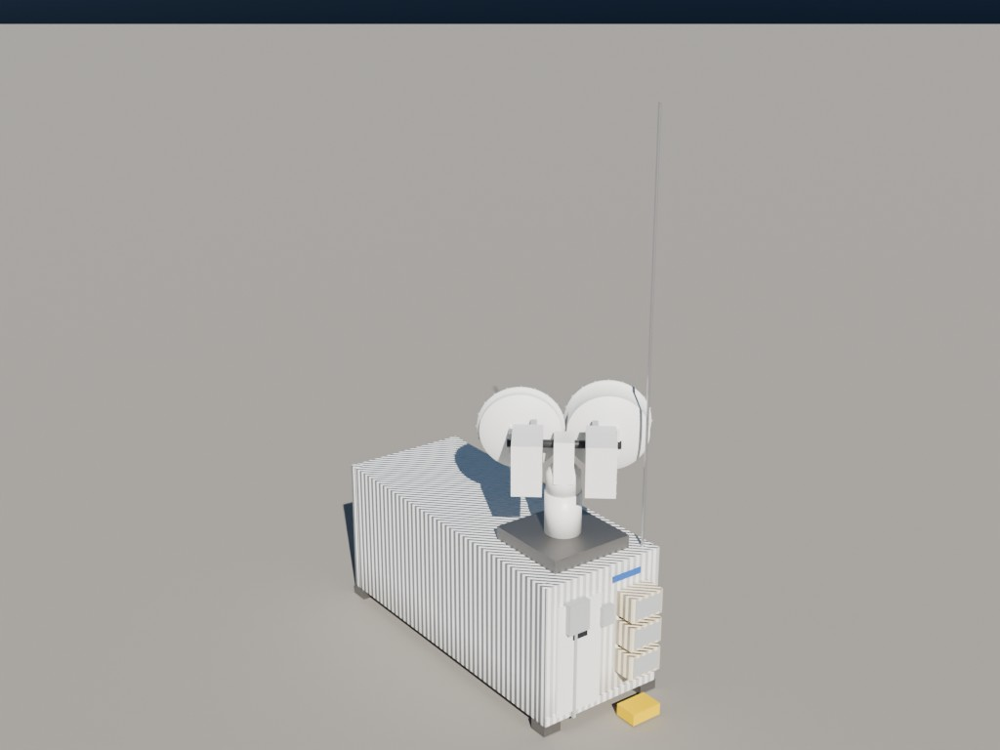

# Containers

AMF2 containers and shelters with their roof-mounted hardware. `CONT_7_SACR_S2` is the SACR container as configured at S2 (KAWG).

| Preview | Collection | File |
|---|---|---|
|  | `CONT_RentalContainer` | [`amf2_containers.blend`](amf2_containers.blend) (0.2 MB) |
|  | `CONT_OfficeShelter` | [`amf2_containers.blend`](amf2_containers.blend) (0.2 MB) |
|  | `CONT_AOS_Platform` | [`amf2_containers.blend`](amf2_containers.blend) (0.2 MB) |
|  | `CONT_8_STORAGE` | [`amf2_containers.blend`](amf2_containers.blend) (0.2 MB) |
|  | `CONT_7_SACR` | [`amf2_containers.blend`](amf2_containers.blend) (0.2 MB) |
|  | `CONT_6_KAZR` | [`amf2_containers.blend`](amf2_containers.blend) (0.2 MB) |
|  | `CONT_5_LIDAR` | [`amf2_containers.blend`](amf2_containers.blend) (0.2 MB) |
|  | `CONT_4_RADIOMETERS` | [`amf2_containers.blend`](amf2_containers.blend) (0.2 MB) |
|  | `CONT_3_OPS` | [`amf2_containers.blend`](amf2_containers.blend) (0.2 MB) |
|  | `CONT_2_AOS_B` | [`amf2_containers.blend`](amf2_containers.blend) (0.2 MB) |
|  | `CONT_1_AOS_A` | [`amf2_containers.blend`](amf2_containers.blend) (0.2 MB) |
|  | `CONT_7_SACR_S2` | [`sacr_container_s2.blend`](sacr_container_s2.blend) (0.1 MB) |
