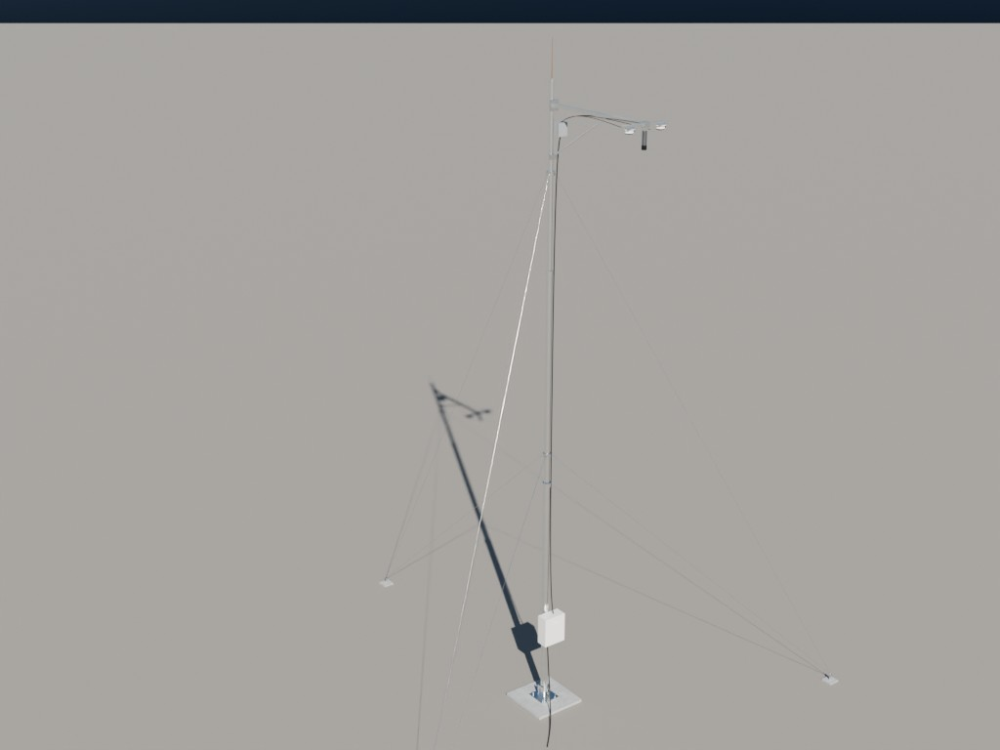
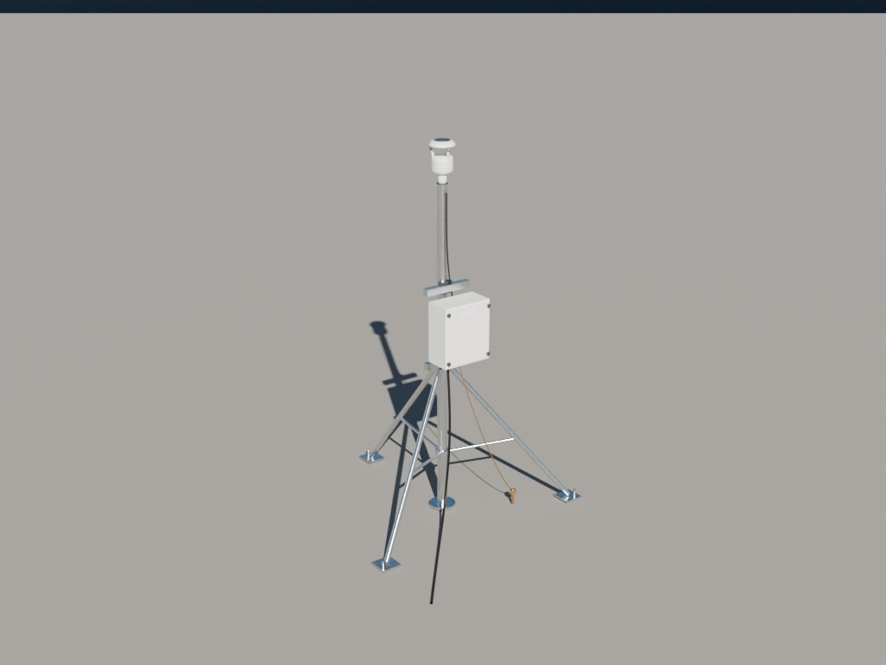
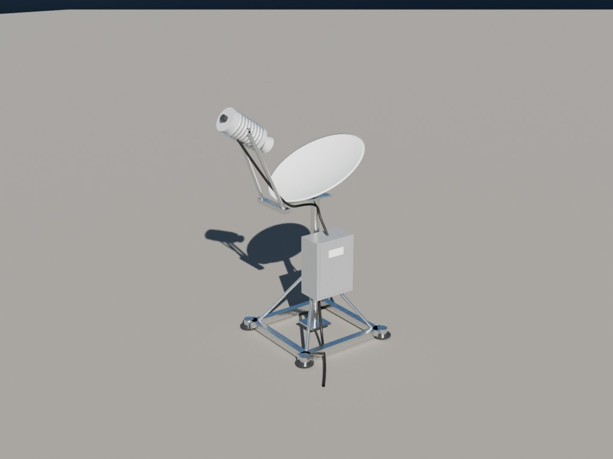
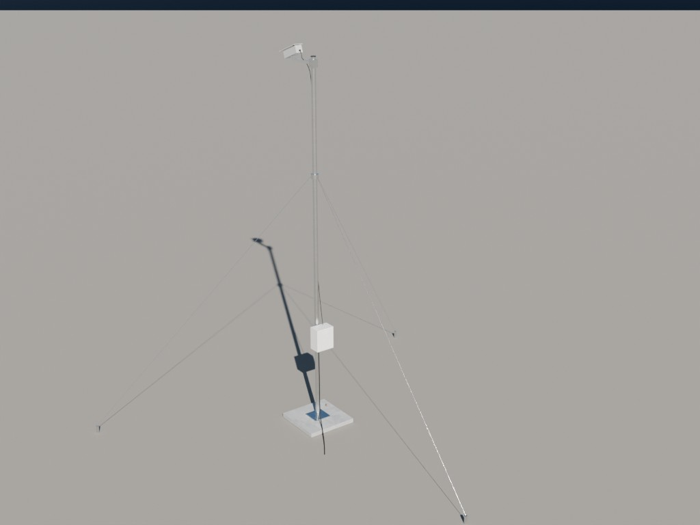
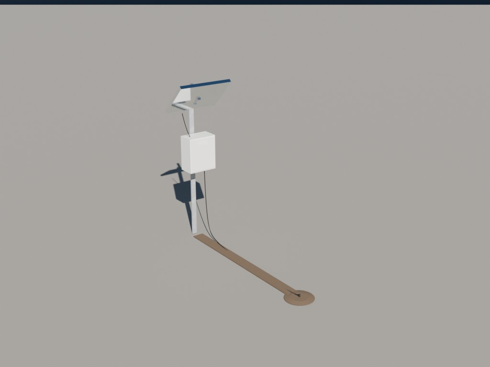
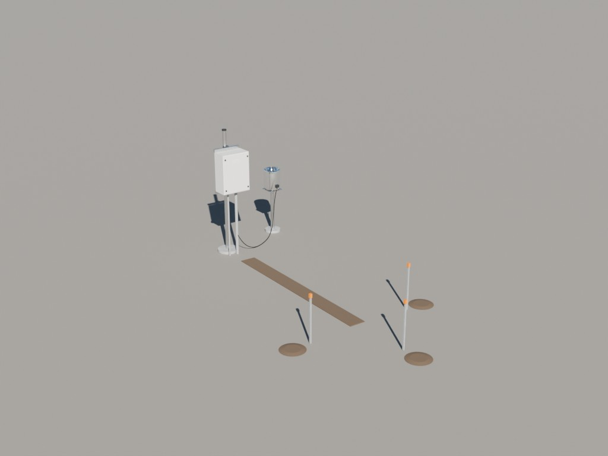

# Instruments

One file per instrument; link the `INST_*` (or `CSAPR2`) collection. Root at the origin.

`INST_BALLOON` is the radiosonde launch at M1: balloon, sonde, the line (a stretch-to constraint from sonde to balloon) and the two-person launch crew (`BALLOON_Crew`). It carries the release animation over frames 1–480; the *_Hold/*_Release crew poses swap visibility at release.

`INST_GNDRAD`, `INST_METWXT`, `INST_MRR`, `INST_PHENOCAM`, `INST_SOILVUE10` and `INST_STAMP` are procedural (rebuild with `blender -b --factory-startup --python tools/build_inst_<name>.py`; helpers in `tools/instlib.py`). Each root carries `full_name`, `sites`, `sources` and `notes` custom properties. Parts below grade (probes, footings, driven stakes, ground rods) sit in a `<NAME>_BelowGrade` child collection that is hidden in viewport and render; un-hide it for cut-away views. Their `bbox_*` describe what stands above ground and `below_grade_m` gives the depth.

| Preview | Collection | File |
|---|---|---|
|  | `INST_AERI` | [`AERI/AERI.blend`](AERI/AERI.blend) (0.2 MB) |
|  | `INST_AOSMET` | [`AOSMET/AOSMET.blend`](AOSMET/AOSMET.blend) (0.1 MB) |
|  | `INST_ASI` | [`ASI/ASI.blend`](ASI/ASI.blend) (0.2 MB) |
|  | `INST_AWOS` | [`AWOS/AWOS.blend`](AWOS/AWOS.blend) (0.3 MB) |
|  | `INST_BALLOON` | [`BALLOON/BALLOON.blend`](BALLOON/BALLOON.blend) (1.9 MB) |
|  | `INST_CEIL` | [`CEIL/CEIL.blend`](CEIL/CEIL.blend) (0.1 MB) |
|  | `CSAPR2` | [`CSAPR2/CSAPR2.blend`](CSAPR2/CSAPR2.blend) (1.2 MB) |
|  | `INST_CSPHOT` | [`CSPHOT/CSPHOT.blend`](CSPHOT/CSPHOT.blend) (0.2 MB) |
|  | `INST_DL` | [`DL/DL.blend`](DL/DL.blend) (0.2 MB) |
|  | `INST_ECOR` | [`ECOR/ECOR.blend`](ECOR/ECOR.blend) (0.3 MB) |
|  | `INST_ECOR_4m` | [`ECOR/ECOR.blend`](ECOR/ECOR.blend) (0.3 MB) |
|  | `INST_GNDRAD` | [`GNDRAD/GNDRAD.blend`](GNDRAD/GNDRAD.blend) (0.2 MB) |
|  | `INST_IRT` | [`IRT/IRT.blend`](IRT/IRT.blend) (0.1 MB) |
|  | `INST_KAZR` | [`KAZR/KAZR.blend`](KAZR/KAZR.blend) (0.2 MB) |
|  | `INST_LDIS` | [`LDIS/LDIS.blend`](LDIS/LDIS.blend) (0.1 MB) |
|  | `INST_MAWS` | [`MAWS/MAWS.blend`](MAWS/MAWS.blend) (0.2 MB) |
|  | `INST_MET` | [`MET/MET.blend`](MET/MET.blend) (0.3 MB) |
|  | `INST_METWXT` | [`METWXT/METWXT.blend`](METWXT/METWXT.blend) (0.2 MB) |
|  | `INST_MFR` | [`MFR/MFR.blend`](MFR/MFR.blend) (0.1 MB) |
|  | `INST_MFRSR` | [`MFRSR/MFRSR.blend`](MFRSR/MFRSR.blend) (0.1 MB) |
|  | `INST_MPL` | [`MPL/MPL.blend`](MPL/MPL.blend) (0.1 MB) |
|  | `INST_MRR` | [`MRR/MRR.blend`](MRR/MRR.blend) (0.2 MB) |
|  | `INST_MWR3C` | [`MWR3C/MWR3C.blend`](MWR3C/MWR3C.blend) (0.2 MB) |
|  | `INST_PHENOCAM` | [`PHENOCAM/PHENOCAM.blend`](PHENOCAM/PHENOCAM.blend) (0.1 MB) |
|  | `INST_RWP` | [`RWP/RWP.blend`](RWP/RWP.blend) (0.3 MB) |
|  | `INST_SEBS` | [`SEBS/SEBS.blend`](SEBS/SEBS.blend) (0.2 MB) |
|  | `INST_SIRS` | [`SIRS/SIRS.blend`](SIRS/SIRS.blend) (0.3 MB) |
|  | `INST_SOILVUE10` | [`SOILVUE10/SOILVUE10.blend`](SOILVUE10/SOILVUE10.blend) (0.2 MB) |
|  | `INST_SONDE` | [`SONDE/SONDE.blend`](SONDE/SONDE.blend) (0.2 MB) |
|  | `INST_STAMP` | [`STAMP/STAMP.blend`](STAMP/STAMP.blend) (0.2 MB) |
|  | `INST_VDIS` | [`VDIS/VDIS.blend`](VDIS/VDIS.blend) (0.1 MB) |
|  | `INST_WB` | [`WB/WB.blend`](WB/WB.blend) (0.2 MB) |
