# Plants

Prototype collections used by the geometry-node scatterers in the site layers. `_HD` sets are the high-detail trees used at S1/S2; `_S2` grasses are the KAWG lawn variants.

| Preview | Collection | File |
|---|---|---|
| 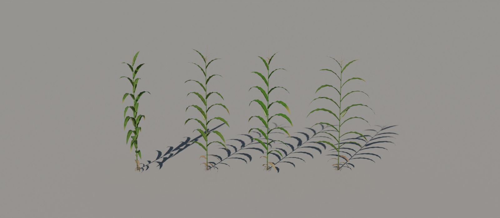 | `CornVariants` | [`crops.blend`](crops.blend) (0.7 MB) |
| 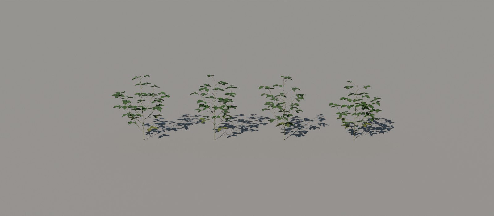 | `SoyVariants` | [`crops.blend`](crops.blend) (0.7 MB) |
| 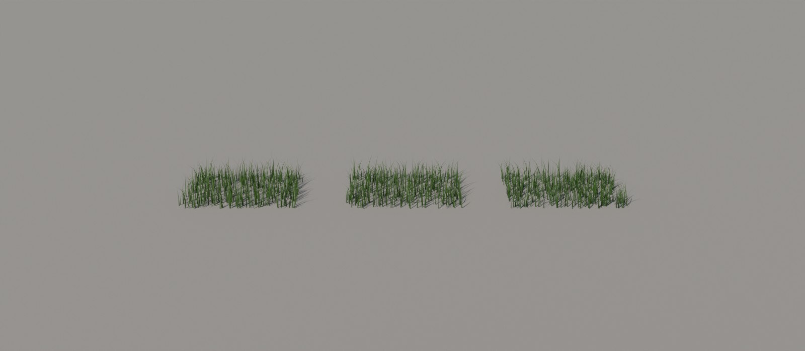 | `GrassVariants` | [`grasses.blend`](grasses.blend) (0.3 MB) |
| 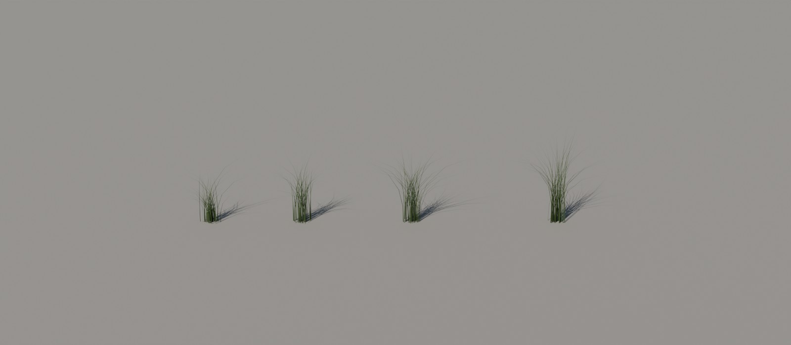 | `TallGrassVariants` | [`grasses.blend`](grasses.blend) (0.3 MB) |
| 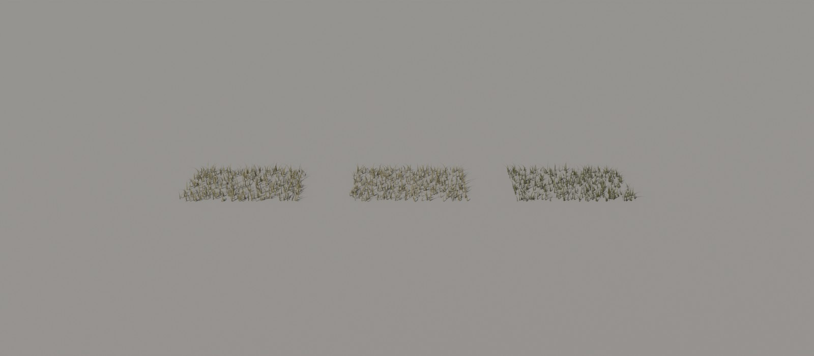 | `GrassVariants_S2` | [`grasses_s2.blend`](grasses_s2.blend) (0.3 MB) |
| 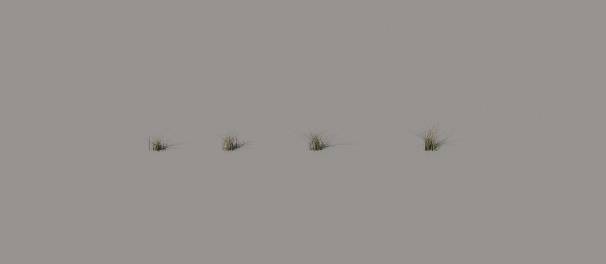 | `TallGrassVariants_S2` | [`grasses_s2.blend`](grasses_s2.blend) (0.3 MB) |
| 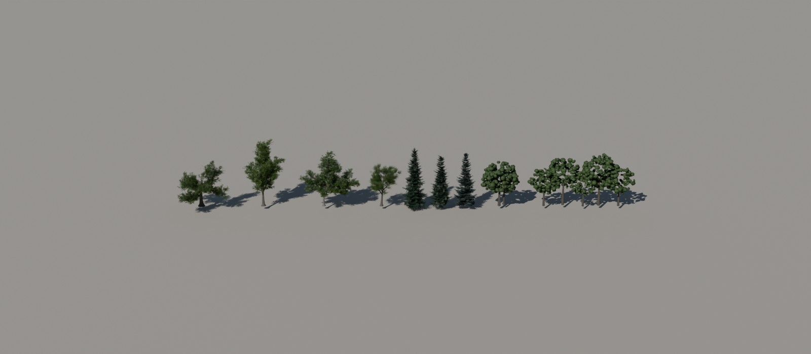 | `TreeVariants` | [`trees.blend`](trees.blend) (3.4 MB) |
| 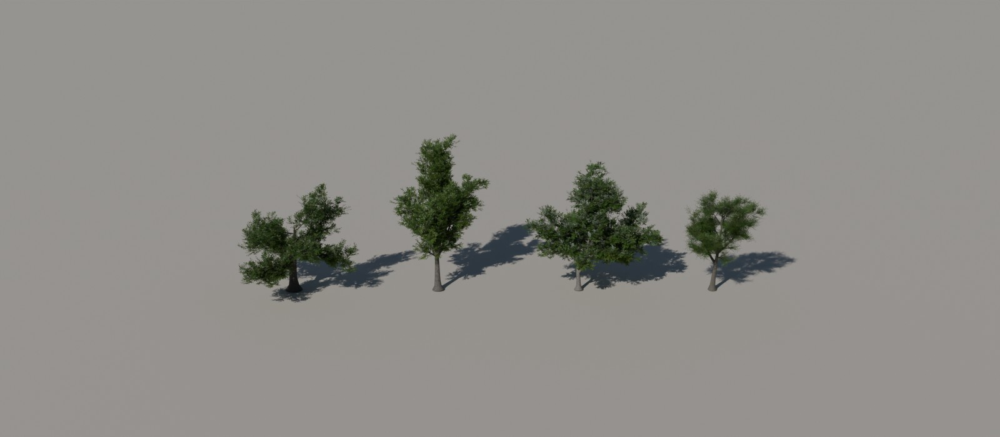 | `TV_Decid_HD` | [`trees_hd.blend`](trees_hd.blend) (42.9 MB) |
| 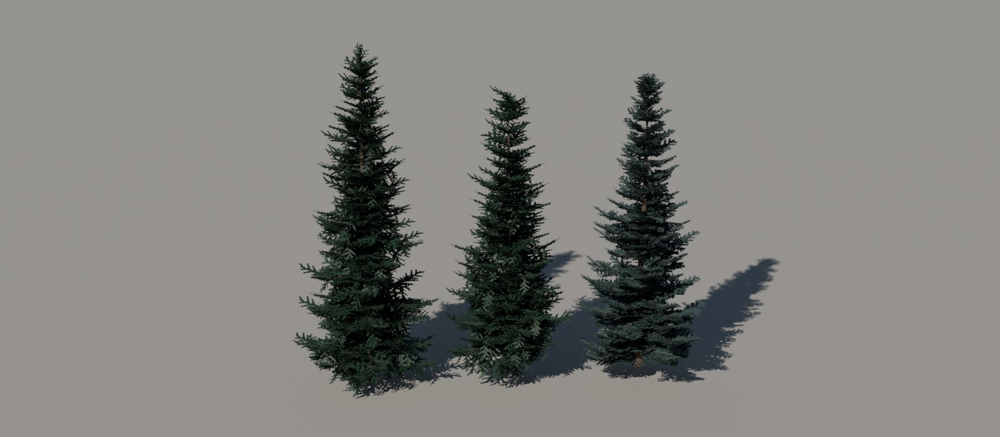 | `TV_Spruce_HD` | [`trees_hd.blend`](trees_hd.blend) (42.9 MB) |
| 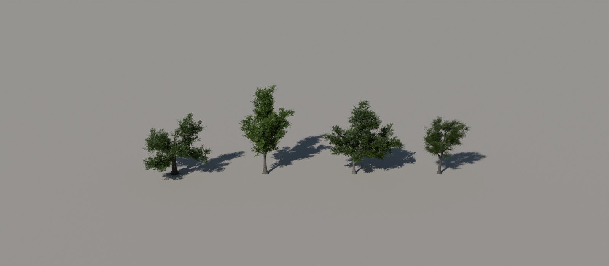 | `TV_DecidBaked_HD` | [`trees_hd.blend`](trees_hd.blend) (42.9 MB) |
| 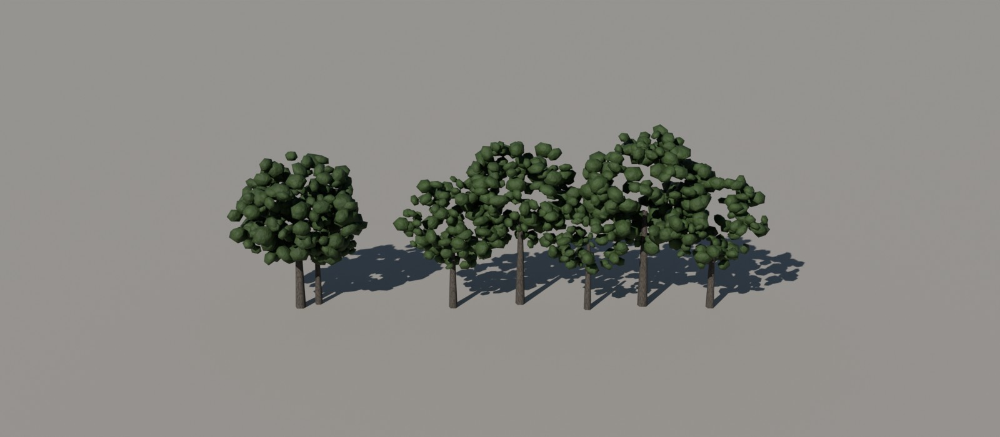 | `TV_Far_HD` | [`trees_hd.blend`](trees_hd.blend) (42.9 MB) |
| 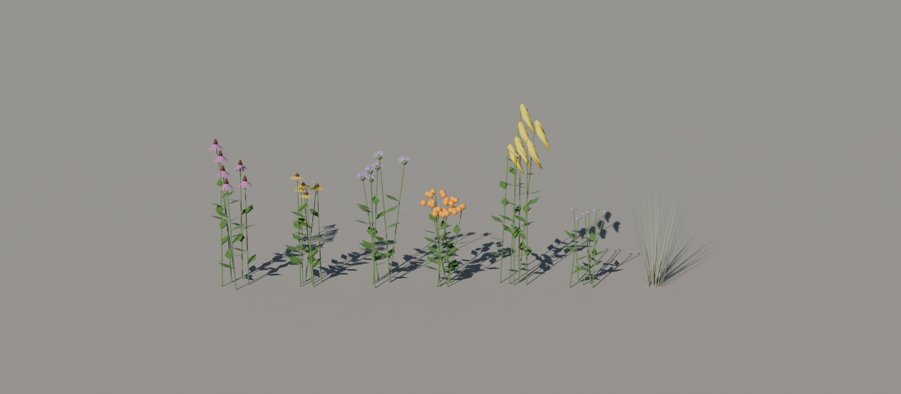 | `NativeFlowerVariants` | [`native_flowers.blend`](native_flowers.blend) (0.2 MB) |
