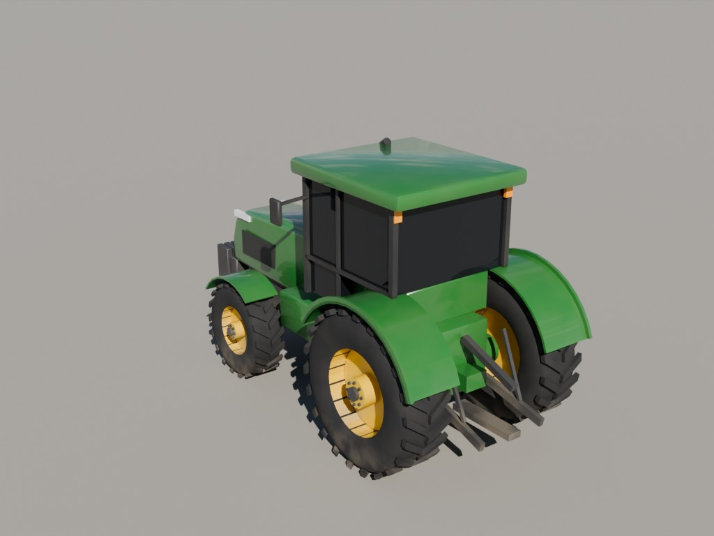
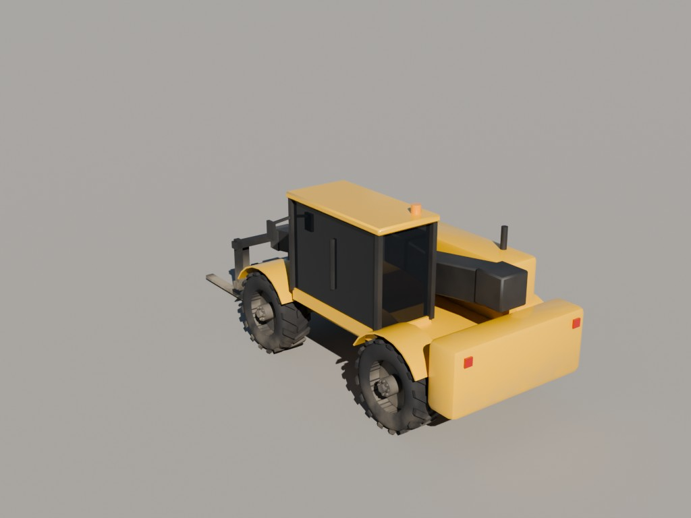
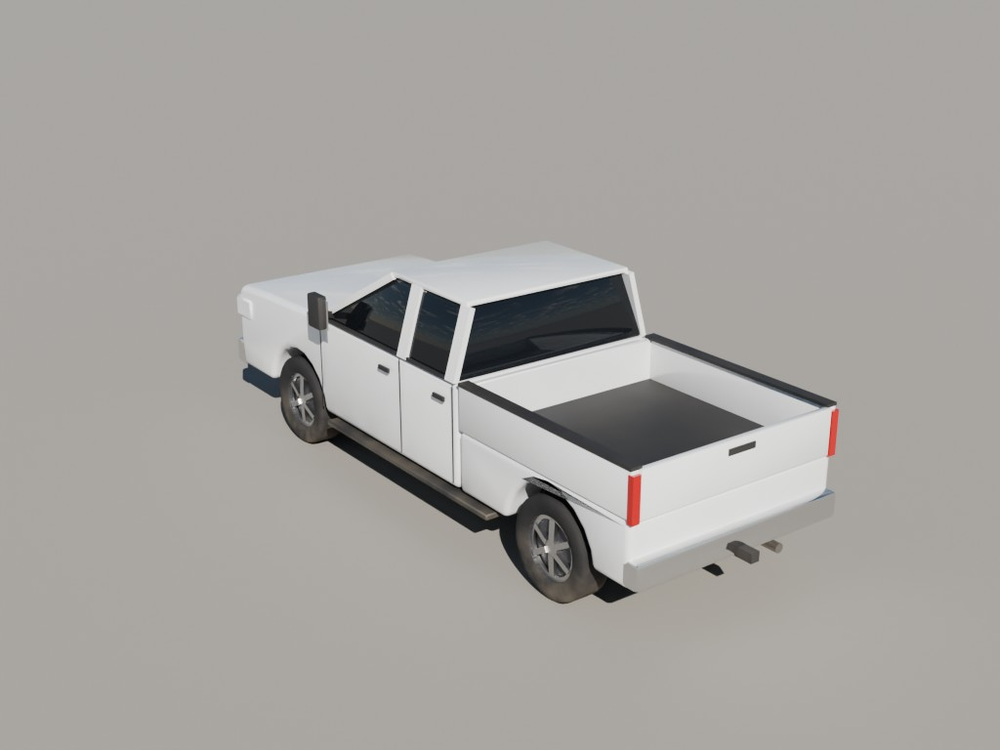
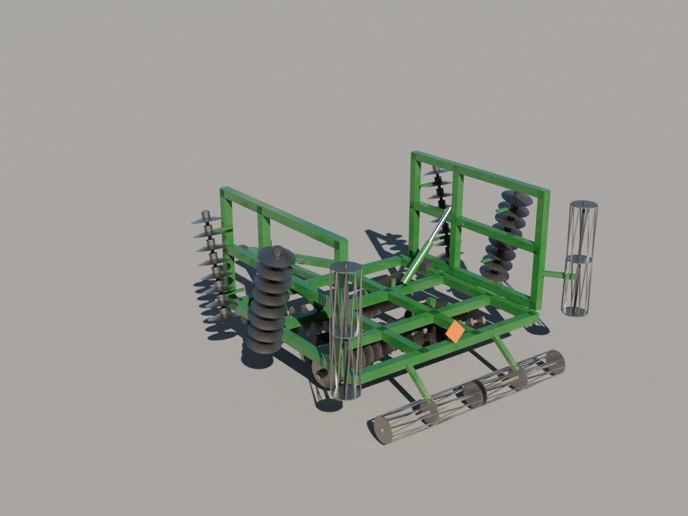
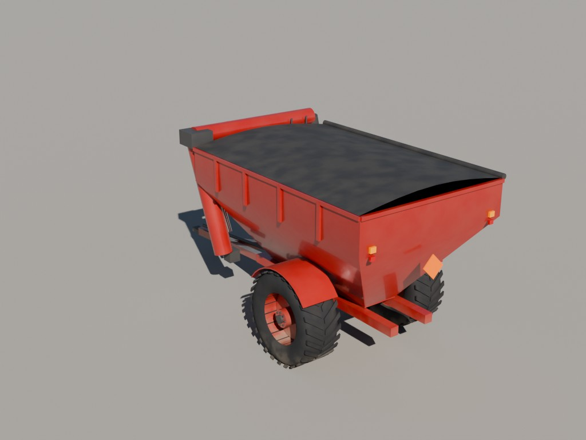
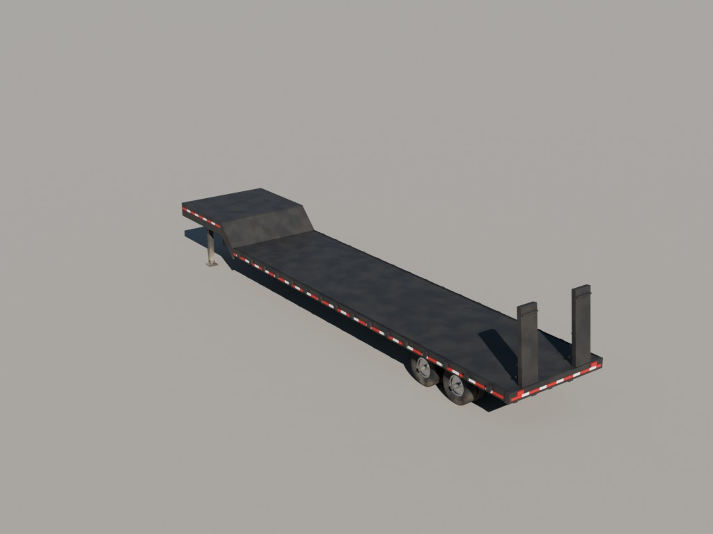
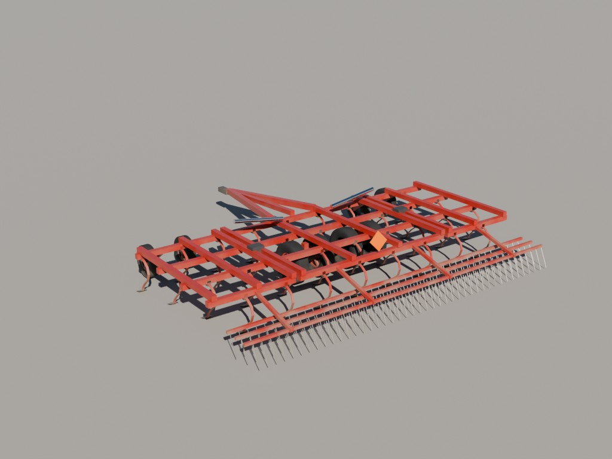

# Vehicles

Farm vehicles/implements and the ARM Bombardier Challenger 850 (`C850_ARM`, gear/flaps/fans driven from custom properties on `C850_root`).

| Preview | Collection | File |
|---|---|---|
|  | `VEH_Tractor_Green` | [`farm_vehicles.blend`](farm_vehicles.blend) (1.0 MB) |
|  | `VEH_Telehandler_Yellow` | [`farm_vehicles.blend`](farm_vehicles.blend) (1.0 MB) |
|  | `VEH_Pickup_White` | [`farm_vehicles.blend`](farm_vehicles.blend) (1.0 MB) |
|  | `VEH_Implement_Disk_Green` | [`farm_vehicles.blend`](farm_vehicles.blend) (1.0 MB) |
|  | `VEH_GrainCart_Red` | [`farm_vehicles.blend`](farm_vehicles.blend) (1.0 MB) |
|  | `VEH_Gooseneck_Flatbed` | [`farm_vehicles.blend`](farm_vehicles.blend) (1.0 MB) |
|  | `VEH_Cultivator_Red` | [`farm_vehicles.blend`](farm_vehicles.blend) (1.0 MB) |
|  | `C850_ARM` | [`c850_arm.blend`](c850_arm.blend) (5.6 MB) |
